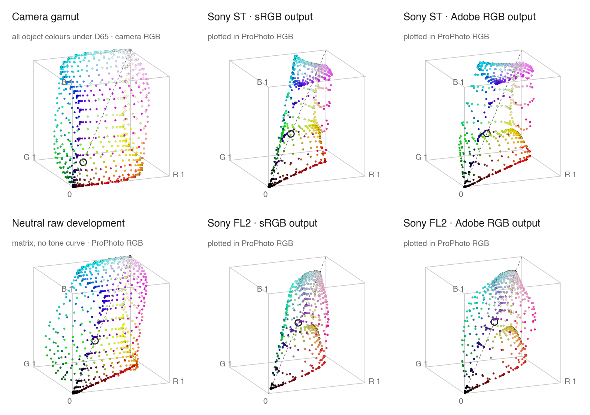

# Sony A7M5 Creative Looks → Capture One / Camera Raw / DxO PhotoLab

English | [中文](README.zh-CN.md)

Camera Raw still has no profiles for the A7M5's Creative Looks. This repository ports all 12 Creative Looks of the Sony α7 V (ILCE-7M5) to Capture One, Adobe Camera Raw / Lightroom and DxO PhotoLab, based on a reverse-engineered model of Sony Imaging Edge Edit — ST, VV, NT, PT, FL, VV2, IN, SH, BW, SE, FL2 and FL3.

The profiles reproduce the look's colour and tone. Compared with Edit, the remaining chroma difference is below what the eye can see.

Video walkthrough (in Chinese): [Bilibili](https://www.bilibili.com/video/BV1VUH56pECK/)


## Results

Each profile was rendered from the same ARW and compared with Edit's export of that look. Test image DSC03591; the images were registered, reduced 8×, and compared as mean absolute error in 8-bit units. The reference column is the complete Edit pipeline ported in this repository (`sonylook/sony_decode.py`: demosaicing, lens correction, sharpening and Spica, Marble), so unlike the profiles it also contains the spatial processing.

| Look | Capture One | Camera Raw | Reference: full Edit chain |
| --- | --- | --- | --- |
| ST | 1.17 | 1.27 | 0.08 |
| FL2 | 1.05 | 1.15 | 0.08 |
| FL3 | 1.21 | 1.27 | 0.09 |

*The Capture One and Camera Raw columns are exports from 2026-10-16, made before SSCS entered the profiles in v1.1.0; the SSCS bullet below measures that change.*

- **Colour and tone:** the full chain matches Edit to ΔE₀₀ 0.02–0.03 in flat areas and 0.04–0.05 on texture. The look mapping and the stages around it are essentially exact.
- **Flat areas:** the host exports differ from Edit by ΔE₀₀ ≈ 0.5 for ST (both hosts) and 0.6–0.9 for FL2/FL3 in Camera Raw. That error is the profiles' interpolation plus the hosts' own rendering, not the look mapping.
- **Global colour shift:** over flat areas the mean Lab difference in Camera Raw is ΔE₀₀ 0.25–0.79 across the three looks, with chroma difference ΔC* of +0.00 / +0.09 / +0.11 (ST / FL2 / FL3). In Capture One (ST) the chroma difference is ≈ −0.20. None is visible.
- **Edges and fine texture:** this is where the host difference sits. In Camera Raw the error is 0.6–0.9 in flat areas and 5.6–6.1 in textured ones; the full chain stays at ~0.1 in the same textured areas. It comes from each program's own demosaicing and sharpening, not from the look.
- **Synthetic chart:** profile vs. Sony look target is 0.10–0.15 for Capture One and 0.14 for Camera Raw (64³ table).
- **Bright, saturated colours (v1.1.0):** the profiles now include Sony's SSCS stage, which pulls bright, saturated colours towards their luma. On the ~5% of DSC03591 that it touches, ST's colour error against Edit drops from 0.64 to 0.16 in Capture One and from 0.61 to 0.33 in Camera Raw.
- **DxO PhotoLab (v1.2.0):** an ST export of DSC03591 from PhotoLab 10.1 (base DCP + look LUT, as-shot white balance) matches the look chain rendered with the same white balance to 1.18, with a mean colour shift of 0.25–0.67 per channel. It has not yet been compared with an Edit export. Up to about 1.7 stops below clipping PhotoLab passes colours through linearly (chart error 0.11); above that its own highlight handling takes over, and colour patches there differ by 4.6 on average (26 at most).
- **Coverage:** only ST, FL2 and FL3 have Edit exports to compare against; the other nine looks run through the same verified code with their own data but have not been checked against a Sony rendering. The FL2/FL3 numbers above are for Fade 0, which is what Edit uses for them. Since v1.0.2 the profiles apply the camera's default Fade (FL2/FL3 = 1, IN = 3, SH = 6), which Edit omits for FL2/FL3. That change has not yet been checked against in-camera JPEGs.

## Installation

### Capture One

1. Copy `profiles/capture_one/SonyA7M5-Look-*.icc` to `~/Library/ColorSync/Profiles/`.
2. **Restart** Capture One, which caches profiles it has already loaded.
3. In *Base Characteristics*, set *ICC Profile* to `SonyA7M5 Look XX` and **Curve to Linear Response**.

### Camera Raw / Lightroom

1. Copy `profiles/camera_raw/SonyA7M5 Linear Base.dcp` to `~/Library/Application Support/Adobe/CameraRaw/CameraProfiles/`.
2. Copy `profiles/camera_raw/SonyA7M5 Look *.xmp` to `~/Library/Application Support/Adobe/CameraRaw/Settings/`.
3. Restart Photoshop / Lightroom and pick a look from the **Sony A7M5** group in the profile browser.
4. To match Sony's rendering exactly, turn off *Use Profile Corrections*. Adobe's lens profile also corrects vignetting, which Edit does not, so with it on the corners come out 20–27% brighter.

> ⚠️ Compatibility note: some Photoshop / Lightroom versions may not load these profiles correctly (for example, missing profiles or incorrect rendering). If that happens, update to a newer version.

On Windows the folders are `%APPDATA%\Adobe\CameraRaw\CameraProfiles` and `%APPDATA%\Adobe\CameraRaw\Settings` (untested).

### DxO PhotoLab

Requires **Elite** PhotoLab (the *LUT Grading* palette is Elite-only); tested with PhotoLab 10.1 on macOS. PhotoLab refers to the DCP and LUT files by path, so keep them in a permanent folder.

1. Copy `profiles/dxo/SonyA7M5 Linear Base v2.dcp` and `profiles/dxo/SonyA7M5 Look *.cube` to that folder.
2. Start from the **6 – No correction** preset, or make sure Smart Lighting, ClearView and Contrast are off. Lens corrections (distortion, chromatic aberration, lens sharpness) can be switched back on; they do not change the look's colour.
3. *Color/B&W Rendering*: Type **DCP Profile** → *Import DCP Profile…* → `SonyA7M5 Linear Base v2.dcp`. Set **DCP Curve to Adobe**, Intensity 100, and **Protect Saturated Colors to 0** (switch off its automatic mode).
4. *DxO PL Elite – LUT Grading*: LUT file → *Import (.cube)…* → `SonyA7M5 Look XX.cube`; **LUT Color Space ProPhoto RGB**, Intensity 100.
5. Optionally save these settings as a preset; switch looks by choosing another `.cube`.

### Scope

- The profiles are made for A7M5 raw files. Other cameras show some colour difference, though within visual tolerance.
- The profiles replace only the look's colour and tone. DRO, sharpening and noise reduction are not included.

## How it works

### Overview

A Sony Creative Look can be treated as a deterministic colour mapping *f* from **white-balanced native camera RGB** to **display-encoded sRGB**. The port takes three steps:

1. Reproduce the computation of *f*.
2. Discretise *f* into a 3D lookup table.
3. Measure the encoding *E* that the target program applies to its input before the profile, and compensate for it in the table.

The profile therefore stores *f* ∘ *E*⁻¹. The program applies *E* and then the table, and the composition yields *f*.

```
camera RGB ──E (target program's input encoding)──▶ profile: f ∘ E⁻¹ ──▶ output = f(camera RGB)
```

The figure shows what *f* does to colour. On the left is every colour the camera can record from a surface lit by daylight: the boundary of the object-colour solid (all reflectances 0–1 under D65), in white-balanced camera RGB, linear, 1 = diffuse white. These are the most saturated real surface colours. The other panels show where those points land after each mapping, all on the same ProPhoto RGB axes, a space wide enough to hold almost every real colour. Edit can export a look in sRGB or Adobe RGB, and the two differ: in Adobe RGB mode the look multiplies in an sRGB → Adobe RGB matrix right after LinearMatrix16, so the rest of the chain runs on wider primaries. Every point is drawn in its own output colour, and the ring marks 18% grey.

<picture>
  <source media="(prefers-color-scheme: dark)" srcset="images/color_cube_en_dark.png">
  
</picture>

- **Neutral raw development** (camera matrix into ProPhoto RGB, no tone curve): the solid keeps its shape; nothing is compressed. Mean chroma C* 80.
- **ST**: highlights converge on white. In sRGB output every colour is folded into the narrow sRGB wedge (mean chroma 55); in Adobe RGB output 30% of the colours stay outside sRGB, mainly yellows, greens and cyans (mean chroma 59). Mid grey is the same in both.
- **FL2**: pulled well towards the grey axis, so the output space matters little: 4% of the colours leave sRGB in Adobe RGB mode, and mean chroma is 37 vs 38. Black is lifted to 0.03 (about 8/255) and mid grey is raised from 0.463 to 0.588.

The profiles in this repository reproduce the **sRGB** output.

The figure is generated by `images/make_color_cube.py` from the look parameters in DSC03591. The ARW carries no spectral sensitivities, so the camera's colour matrix stands in for the sensor.

### 1. Reproducing the look mapping *f*

Static analysis of Imaging Edge Edit 4.0 shows that the look chain consists of the following per-pixel stages:

1. **LinearMatrix16**: a 3×3 matrix plus a quadratic term, selected by hue (1024 steps). It carries both the camera colour correction and the look's colour character.
2. **MainGamma**: a per-channel 1D tone curve.
3. **RGB2YCC**: conversion to luma/colour-difference, with a separate shear and gain in each quadrant of the colour-difference plane. In effect, hue and saturation are adjusted per region.
4. **ChromaSuppress / AreaComp**: chroma suppression in deep shadows and bright highlights, plus a small adjustment near neutral.
5. **YGamma**: a luma curve with a highlight knee and an overall gain. The look's Fade setting acts here: any Fade above 0 adds a fixed lift to the shadows and lowers the gain step by step.
6. **YCC2RGB**: inverse BT.601.
7. **Effect** (BW and SE only): conversion to monochrome, plus the sepia tint.

Further points:

- The front end only subtracts the black level and applies white-balance gains. There is no camera matrix.
- The camera writes every look's parameters into the encrypted SR2 data of the ARW. All 12 looks share one implementation.
- The Python implementation (`sonylook/`) is bit-exact against the original program. This was verified against the output of the original ARM64 code run under emulation.
- Each look is rendered with the camera's default Creative Look settings. Contrast, highlights, shadows and saturation are 0 for all twelve; Fade is 1 for FL2/FL3, 3 for IN and 6 for SH.
- Sharpening, noise reduction, clarity and DRO depend on neighbouring pixels, so they are not per-pixel mappings and are left out of the profiles.
- The decoder's demosaic (ZcTaskITP) is ported bit-exactly in `sonylook/sony_itp.py`, including Sony's 1024-pixel tiling; it is not part of the profiles.
- The whole decoder is wired end to end in `sonylook/sony_decode.py`: `decode(arw)` runs RawNR, ITP, DRO, lens geometry, SSCS, the look chain and Marble. Against Edit's export of DSC03591 the whole 7008×4672 image matches at 0.13 (8-bit MAE). `--rust` runs the same stages through the optional Rust core, with bit-identical output.
- The profiles also include SSCS (`sonylook/sony_sscs.py`). Strictly speaking it is a decoder stage that runs before the look, but it is per pixel and improves both hosts (see above). Edit's 3D LUT stage is off at default settings; hue/saturation runs only when those sliders are non-zero. The tone-curve tool (Y/R/G/B) and peripheral-illumination correction are ported bit-exactly in `sonylook/sony_tonecurve.py` / `sony_shade.py` and run at the end of the chain when their settings are non-default.

### 2. Lookup-table representation

Because *f* is per-pixel, it can be evaluated in advance on a regular grid over the input space. Any other input is then approximated by interpolation.

- **Capture One:** the A2B0 table of an input ICC profile, 65³ grid, with a square-root shaper curve to sample the shadows more densely.
- **Camera Raw:** the RGBTable of an XMP profile, 64³ grid.
- **DxO PhotoLab:** a 64³ `.cube` LUT, read in ProPhoto RGB (gamma 1.8).

Interpolation error on the test photo is about 0.2–0.5 (8-bit units).

### 3. Calibrating the input encoding *E*

The target programs do not pass linear camera RGB to the profile. They pass values after an internal encoding *E*, which is not documented. It was measured experimentally:

- **Synthetic chart:** the raw data of an ARW was rewritten into 264 patches: a 48-step grey ramp plus a 6³ cube in camera RGB. Each patch's linear value is derived from Sony's front-end gains, so it is known exactly.
- **Probe profiles:**
  - an identity probe outputs its input, which measures *E*;
  - a square probe and a luma probe test whether any further tone or colour processing follows the profile.

Results:

| | Capture One (Linear Response curve) | Camera Raw (linear base DCP) |
| --- | --- | --- |
| Form of *E* | Same 1D curve on each channel, channels independent. Linear in the shadows, increasingly compressive in the highlights. Sensor clip maps to 1. | Linear in the mid-tones. Highlight compression preserves hue: max and min channels follow one curve, and the middle channel keeps its linear ratio. |
| Processing after the profile | None (square probe error 0.04, luma probe error 0.02) | None (the RGBTable is the last step) |
| Model residual on the chart | ≈ 0.2 | mean 0.04, max 0.37 |

DxO PhotoLab (base DCP `SonyA7M5 Linear Base v2`, DCP Curve = Adobe, LUT in ProPhoto RGB):

- **Mid-tones:** the LUT input is the white-balanced camera RGB through the base DCP's matrix, linear, with 1.0 at Sony linear 6422 (the same scale as Camera Raw).
- **Highlights:** from about 1.7 stops below clipping, PhotoLab's highlight recovery compresses the brighter channels, and a further compression follows whose source was not located; it is modelled with a curve measured on the grey ramp.
- **Saturated colours:** PhotoLab clips negative components in its DxO Wide Gamut working space, which lifts the weak channel of very saturated greens and blues.
- **After the LUT:** nothing (square probe matches on the grey ramp to 0.03, luma probe 0.33).
- **Model residual on the chart:** 0.11 below the highlight threshold, 4.6 above it (all in colour patches).

Two further points:

- In Capture One, *E* depends on the selected tone curve, so the profiles are valid only with Linear Response.
- The Camera Raw base DCP sets its ForwardMatrix to linear ProPhoto → XYZ D50 and its tone curve to identity. Camera Raw's working space then equals white-balanced camera RGB, and Adobe's own colour and tone are not added.

The pipeline is summarised in [docs/pipeline.md](docs/pipeline.md) (final conclusions; the derivations are in its git history), and the host calibrations in [docs/capture_one.md](docs/capture_one.md), [docs/camera_raw.md](docs/camera_raw.md) and [docs/dxo.md](docs/dxo.md) (all Chinese).

## Regenerating the profiles

### Requirements

- Python 3.11+ with `pip install -r requirements.txt`.
- Any A7M5 ARW.
- **Imaging Edge Edit 4.0.00.10312** installed locally (macOS).
- Optional: a Rust toolchain (`cargo`) for the accelerated `--rust` decoder. The NumPy path needs no Rust; the one-time LUTs are cached under `~/.cache/sonylook` (`SONYLOOK_CACHE=0` disables, `SONYLOOK_CACHE_DIR` moves it).

A few constant tables used by the look chain are read at run time from your own Edit installation (`sonylook/edit_binary.py`); examples are the hue atan table and the contrast curve family. This repository contains no Sony binaries or data. The script checks the SHA-256 of the arm64 slice, because table addresses differ between builds. Set `SONY_EDIT_BINARY` to use a different path.

### Commands

Build the Capture One profiles:

```bash
python3 capture_one/c1_look_profile.py /path/to/A7M5.ARW
```

Build the Camera Raw profiles:

```bash
python3 camera_raw/acr_look.py /path/to/A7M5.ARW --write
```

Build the DxO PhotoLab LUTs (`--eval` also prints the interpolation error on the ARW):

```bash
python3 dxo/dxo_look.py /path/to/A7M5.ARW --write
```

Render previews directly with the look chain:

```bash
python3 sonylook/sony_render.py /path/to/A7M5.ARW Standard FL2 --scale 4
```

Regenerating from DSC03591 reproduces the files in `profiles/` byte for byte.

### Decoding an ARW

The full decoder runs every stage from RawNR to the Creative Look:

```bash
python3 sonylook/sony_decode.py /path/to/A7M5.ARW --out out.tif
```

It writes the 7008×4672 decoder rectangle as a 16-bit TIFF, or an 8-bit JPEG / PNG, in sRGB or Adobe RGB (`--color-space srgb|adobe`, `--bits 8|16`), with the ICC profile bundled with your Edit installation. The look, the optional stages and Edit's Creative Look sliders (contrast, highlights, shadows, hue, saturation, black/white level, sharpness fineness and exposure), plus the tone-curve tool (Y/R/G/B) and peripheral-illumination correction, follow Edit's saved develop settings when the ARW has them, and otherwise the values Edit starts from for an unsaved file (as-shot look, NR and DRO from the camera, lens corrections on, the look's default clarity, sliders at 0); `--no-nr`, `--no-dro`, `--no-marble`, `--no-detail`, `--no-lens` and `--no-sscs` turn them off.

An optional Rust core (`rust/sonylook_core`) fuses the pointwise part of the render band, Sharpness / YGamma / Spica / YCC2RGB, and ports GeoCorr, the ITP demosaic, Marble and SSCS. Build it with `cargo build --release --manifest-path rust/sonylook_core/Cargo.toml`, then add `--rust`. Its output is bit-identical to the NumPy path; on the test image the fused stages drop from 21 s to 0.5 s, GeoCorr from 6.9 s to 0.5 s, ITP from 5.8 s to 0.6 s, Marble from 5 s to 0.5 s, SSCS from 1.4 s to 0.1 s, and the whole decode from 42 s to 3.2 s. The NumPy path remains the default and the reference; the NR/chroma branch of Marble still runs in NumPy. One-time LUT construction is included too: MainGamma and the Effect tables are built in Rust, while the LinearMatrix16/YGamma tables are cached under `~/.cache/sonylook` (`SONYLOOK_CACHE=0` disables, `SONYLOOK_CACHE_DIR` moves it). Thread counts are controlled by `SONYLOOK_THREADS`, `SONYLOOK_BAND_THREADS` and `SONYLOOK_MARBLE_THREADS`; see `rust/README.md`.

### Recalibration (for new software versions)

1. **Chart:** the synthetic chart is in `chart/`. You can also build one from your own A7M5 photo with `python3 capture_one/make_chart.py SOURCE.ARW`, which only reads the source file.
2. **Capture One:**
   - run `c1_look_profile.py --probes` and install the probe profiles;
   - export the chart with *Probe*, then run `measure_chart.py` and `fit_c1_encoding.py`;
   - use *Probe-Sq* / *Probe-Mono* to check that nothing happens after the ICC.
3. **Camera Raw:**
   - run `acr_profiles.py probes` and install the probe profiles;
   - export the chart with *Probe* (16-bit ProPhoto, lens corrections off), then run `measure_acr_chart.py` and `acr_encoding.py`.
4. **DxO PhotoLab:**
   - run `dxo/dxo_profiles.py probes` for the probe LUTs and `dxo/dxo_profiles.py base2` for the base DCP;
   - export the chart with *Probe* (16-bit TIFF, ProPhoto RGB, *Preserve color details* off), then run `measure_acr_chart.py`;
   - the model in `dxo/dxo_model.py` is checked against that measurement.
5. **Photo comparison:** `compare_c1_export.py` / `compare_acr_export.py EXPORT.tif EDIT.tif`. Use `compare_figure.py` for the side-by-side figure.

## Repository layout

| Folder | Contents |
| --- | --- |
| `profiles/` | Generated profiles: Capture One ICC; Camera Raw DCP and XMP; DxO PhotoLab DCP and `.cube` |
| `chart/` | Synthetic chart: `SonyChart.ARW` (opens in Capture One and Camera Raw), patch definitions `SonyChart.json`, preview image |
| `sonylook/` | Python port of Sony's look chain and front end, ARW and Edit readers. Also ports of RawNR, DRO, sharpening / Spica, Marble, lens geometry correction (none used by the profiles) and the BW/SE Effect stage (used), plus the end-to-end decoder `sony_decode.py` |
| `rust/` | Optional Rust core (`sonylook_core`): fused render bands, GeoCorr, ITP, Marble, SSCS and table builders. See `rust/README.md` |
| `capture_one/` | Capture One profile generation, synthetic chart, measurement and comparison |
| `camera_raw/` | Camera Raw table format, DCP read/write, profile generation, measurement and comparison |
| `dxo/` | DxO PhotoLab model of the LUT input (`dxo_model.py`), probe and base-DCP generation, LUT generation |
| `docs/` | Research notes in Chinese: pipeline details and the calibration of Capture One, Camera Raw and DxO PhotoLab. Evidence files and test exports mentioned there are not included |

## Synthetic chart


`chart/SonyChart.ARW` is a valid A7M5 ARW:

- Its raw data was replaced by 264 patches with known linear values: a 48-step grey ramp plus a 6×6×6 cube in camera RGB.
- The metadata (white balance, black level, lens, etc.) is that of the original photo.
- The three embedded JPEGs (thumbnail, preview, full size) were replaced by an ST-look rendering of the chart.
- Raw values, Sony linear values and positions of every patch are listed in `chart/SonyChart.json`.

## Notes

- This project is not affiliated with Sony, Capture One, Adobe or DxO. All names and trademarks belong to their owners.
- The project achieves interoperability by analysing software behaviour. The repository contains no binaries, decompiled code or data extracted from that software. The constants it needs are read on the user's machine from the user's own installation.
- The ColorMatrix values in the Camera Raw profiles come from Adobe Standard's A7M5 profile, so that Camera Raw's white balance behaves unchanged. The DxO base DCP uses Adobe Standard's ColorMatrix and D65 ForwardMatrix for the same reason.
- `dxo/dxo_model.py` re-implements PhotoLab's highlight recovery from its observed behaviour and contains a few values measured from PhotoLab while it runs (the DxO Wide Gamut matrices, the highlight white level); it contains no DxO code or files.

## License

- The code, documentation and the work of generating the profiles are released under the [MIT License](LICENSE).
- The profiles are provided as is. Third-party data contained in them (Sony's look parameters, Adobe's ColorMatrix values) is not covered by this license, and the project claims no rights to it.
