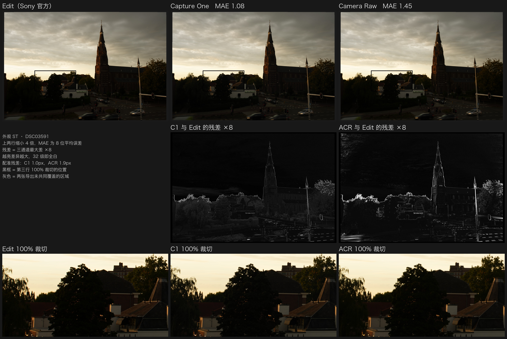
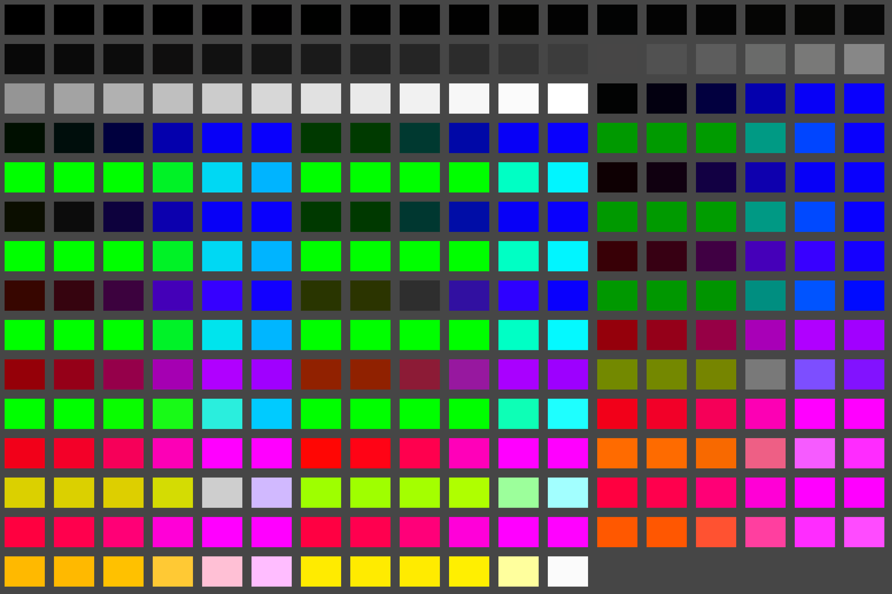

# Sony A7M5 Creative Looks → Capture One / Camera Raw

English | [中文](README.zh-CN.md)

Camera Raw still has no profiles for the A7M5's Creative Looks. This repository ports all 12 Creative Looks of the Sony α7 V (ILCE-7M5) to Capture One and Adobe Camera Raw / Lightroom, based on a reverse-engineered model of Sony Imaging Edge Edit — ST, VV, NT, PT, FL, VV2, IN, SH, BW, SE, FL2 and FL3.

The profiles reproduce the look's colour and tone. Compared with Edit, the remaining chroma difference is below what the eye can see.



## Results

Each profile was rendered from the same ARW and compared with Edit's export of that look. Test image DSC03591; the images were registered, reduced 8×, and compared as mean absolute error in 8-bit units.

| Look | Capture One | Camera Raw | Reference: look chain itself |
| --- | --- | --- | --- |
| ST | 1.17 | 1.27 | 0.90 |
| FL2 | 1.05 | 1.15 | 0.89 |
| FL3 | 1.21 | 1.27 | 1.00 |

- **Flat areas:** ΔE₀₀ ≈ 0.5.
- **Global colour shift:** ΔE₀₀ < 0.4, with chroma difference ΔC* of −0.28 in Capture One and −0.01 in Camera Raw. Neither is visible.
- **Edges and fine texture:** the remaining differences are here. They come from each program's own demosaicing and sharpening, not from the look.
- **Synthetic chart:** profile vs. Sony look target is 0.10–0.15 for Capture One and 0.14 for Camera Raw (64³ table).

## Installation

### Capture One

1. Copy `profiles/capture_one/SonyA7M5-Look-*.icc` to `~/Library/ColorSync/Profiles/`.
2. **Restart** Capture One, which caches profiles it has already loaded.
3. In *Base Characteristics*, set *ICC Profile* to `SonyA7M5 Look XX` and **Curve to Linear Response**.

### Camera Raw / Lightroom

1. Copy `profiles/camera_raw/SonyA7M5 Linear Base.dcp` to `~/Library/Application Support/Adobe/CameraRaw/CameraProfiles/`.
2. Copy `profiles/camera_raw/SonyA7M5 Look *.xmp` to `~/Library/Application Support/Adobe/CameraRaw/Settings/`.
3. Restart Photoshop / Lightroom and pick a look from the **Sony A7M5** group in the profile browser.
4. To match Sony's rendering exactly, turn off *Use Profile Corrections*. Adobe's lens profile also corrects vignetting, which Edit does not, so with it on the corners come out 20–27% brighter.

On Windows the folders are `%APPDATA%\Adobe\CameraRaw\CameraProfiles` and `%APPDATA%\Adobe\CameraRaw\Settings` (untested).

### Scope

- The profiles are made for A7M5 raw files. Other cameras show some colour difference, though within visual tolerance.
- The profiles replace only the look's colour and tone. DRO, sharpening and noise reduction are not included.

## How it works

### Overview

A Sony Creative Look can be treated as a deterministic colour mapping *f* from **white-balanced native camera RGB** to **display-encoded sRGB**. The port takes three steps:

1. Reproduce the computation of *f*.
2. Discretise *f* into a 3D lookup table.
3. Measure the encoding *E* that the target program applies to its input before the profile, and compensate for it in the table.

The profile therefore stores *f* ∘ *E*⁻¹. The program applies *E* and then the table, and the composition yields *f*.

```
camera RGB ──E (target program's input encoding)──▶ profile: f ∘ E⁻¹ ──▶ output = f(camera RGB)
```

### 1. Reproducing the look mapping *f*

Static analysis of Imaging Edge Edit 4.0 shows that the look chain consists of the following per-pixel stages:

1. **LinearMatrix16**: a 3×3 matrix plus a quadratic term, selected by hue (1024 steps). It carries both the camera colour correction and the look's colour character.
2. **MainGamma**: a per-channel 1D tone curve.
3. **RGB2YCC**: conversion to luma/colour-difference, with a separate shear and gain in each quadrant of the colour-difference plane. In effect, hue and saturation are adjusted per region.
4. **ChromaSuppress / AreaComp**: chroma suppression in deep shadows and bright highlights, plus a small adjustment near neutral.
5. **YGamma**: a luma curve with a highlight knee and an overall gain.
6. **YCC2RGB**: inverse BT.601.

Further points:

- The front end only subtracts the black level and applies white-balance gains. There is no camera matrix.
- The camera writes every look's parameters into the encrypted SR2 data of the ARW. All 12 looks share one implementation.
- The Python implementation (`sonylook/`) is bit-exact against the original program. This was verified against the output of the original ARM64 code run under emulation.
- Sharpening, noise reduction and DRO depend on neighbouring pixels, so they are not per-pixel mappings and are left out of the profiles.

### 2. Lookup-table representation

Because *f* is per-pixel, it can be evaluated in advance on a regular grid over the input space. Any other input is then approximated by interpolation.

- **Capture One:** the A2B0 table of an input ICC profile, 65³ grid, with a square-root shaper curve to sample the shadows more densely.
- **Camera Raw:** the RGBTable of an XMP profile, 64³ grid.

Interpolation error on the test photo is about 0.2–0.5 (8-bit units).

### 3. Calibrating the input encoding *E*

The target programs do not pass linear camera RGB to the profile. They pass values after an internal encoding *E*, which is not documented. It was measured experimentally:

- **Synthetic chart:** the raw data of an ARW was rewritten into 264 patches: a 48-step grey ramp plus a 6³ cube in camera RGB. Each patch's linear value is derived from Sony's front-end gains, so it is known exactly.
- **Probe profiles:**
  - an identity probe outputs its input, which measures *E*;
  - a square probe and a luma probe test whether any further tone or colour processing follows the profile.

Results:

| | Capture One (Linear Response curve) | Camera Raw (linear base DCP) |
| --- | --- | --- |
| Form of *E* | Same 1D curve on each channel, channels independent. Linear in the shadows, increasingly compressive in the highlights. Sensor clip maps to 1. | Linear in the mid-tones. Highlight compression preserves hue: max and min channels follow one curve, and the middle channel keeps its linear ratio. |
| Processing after the profile | None (square probe error 0.04, luma probe error 0.02) | None (the RGBTable is the last step) |
| Model residual on the chart | ≈ 0.2 | mean 0.04, max 0.37 |

Two further points:

- In Capture One, *E* depends on the selected tone curve, so the profiles are valid only with Linear Response.
- The Camera Raw base DCP sets its ForwardMatrix to linear ProPhoto → XYZ D50 and its tone curve to identity. Camera Raw's working space then equals white-balanced camera RGB, and Adobe's own colour and tone are not added.

The derivations and intermediate results are in [docs/pipeline.md](docs/pipeline.md), [docs/capture_one.md](docs/capture_one.md) and [docs/camera_raw.md](docs/camera_raw.md) (Chinese).

## Regenerating the profiles

### Requirements

- Python 3.11+ with `pip install -r requirements.txt`.
- Any A7M5 ARW.
- **Imaging Edge Edit 4.0.00.10312** installed locally (macOS).

A few constant tables used by the look chain are read at run time from your own Edit installation (`sonylook/edit_binary.py`); examples are the hue atan table and the contrast curve family. This repository contains no Sony binaries or data. The script checks the SHA-256 of the arm64 slice, because table addresses differ between builds. Set `SONY_EDIT_BINARY` to use a different path.

### Commands

Build the Capture One profiles:

```bash
python3 capture_one/c1_look_profile.py /path/to/A7M5.ARW
```

Build the Camera Raw profiles:

```bash
python3 camera_raw/acr_look.py /path/to/A7M5.ARW --write
```

Render previews directly with the look chain:

```bash
python3 sonylook/sony_render.py /path/to/A7M5.ARW Standard FL2 --scale 4
```

Regenerating from DSC03591 reproduces the files in `profiles/` byte for byte.

### Recalibration (for new software versions)

1. **Chart:** the synthetic chart is in `chart/`. You can also build one from your own A7M5 photo with `python3 capture_one/make_chart.py SOURCE.ARW`, which only reads the source file.
2. **Capture One:**
   - run `c1_look_profile.py --probes` and install the probe profiles;
   - export the chart with *Probe*, then run `measure_chart.py` and `fit_c1_encoding.py`;
   - use *Probe-Sq* / *Probe-Mono* to check that nothing happens after the ICC.
3. **Camera Raw:**
   - run `acr_profiles.py probes` and install the probe profiles;
   - export the chart with *Probe* (16-bit ProPhoto, lens corrections off), then run `measure_acr_chart.py` and `acr_encoding.py`.
4. **Photo comparison:** `compare_c1_export.py` / `compare_acr_export.py EXPORT.tif EDIT.tif`. Use `compare_figure.py` for the side-by-side figure.

## Repository layout

| Folder | Contents |
| --- | --- |
| `profiles/` | Generated profiles: Capture One ICC; Camera Raw DCP and XMP |
| `chart/` | Synthetic chart: `SonyChart.ARW` (opens in Capture One and Camera Raw), patch definitions `SonyChart.json`, preview image |
| `sonylook/` | Python port of Sony's look chain and front end, ARW and Edit readers. Also ports of DRO, sharpening / Spica and lens geometry correction, which the profiles do not use |
| `capture_one/` | Capture One profile generation, synthetic chart, measurement and comparison |
| `camera_raw/` | Camera Raw table format, DCP read/write, profile generation, measurement and comparison |
| `docs/` | Research notes in Chinese: pipeline details and the calibration of Capture One and Camera Raw. Evidence files and test exports mentioned there are not included |

## Synthetic chart



`chart/SonyChart.ARW` is a valid A7M5 ARW:

- Its raw data was replaced by 264 patches with known linear values: a 48-step grey ramp plus a 6×6×6 cube in camera RGB.
- The metadata (white balance, black level, lens, etc.) is that of the original photo.
- The three embedded JPEGs (thumbnail, preview, full size) were replaced by an ST-look rendering of the chart.
- Raw values, Sony linear values and positions of every patch are listed in `chart/SonyChart.json`.

## Notes

- This project is not affiliated with Sony, Capture One or Adobe. All names and trademarks belong to their owners.
- The project achieves interoperability by analysing software behaviour. The repository contains no binaries, decompiled code or data extracted from that software. The constants it needs are read on the user's machine from the user's own installation.
- The ColorMatrix values in the Camera Raw profiles come from Adobe Standard's A7M5 profile, so that Camera Raw's white balance behaves unchanged.

## License

- The code, documentation and the work of generating the profiles are released under the [MIT License](LICENSE).
- The profiles are provided as is. Third-party data contained in them (Sony's look parameters, Adobe's ColorMatrix values) is not covered by this license, and the project claims no rights to it.
